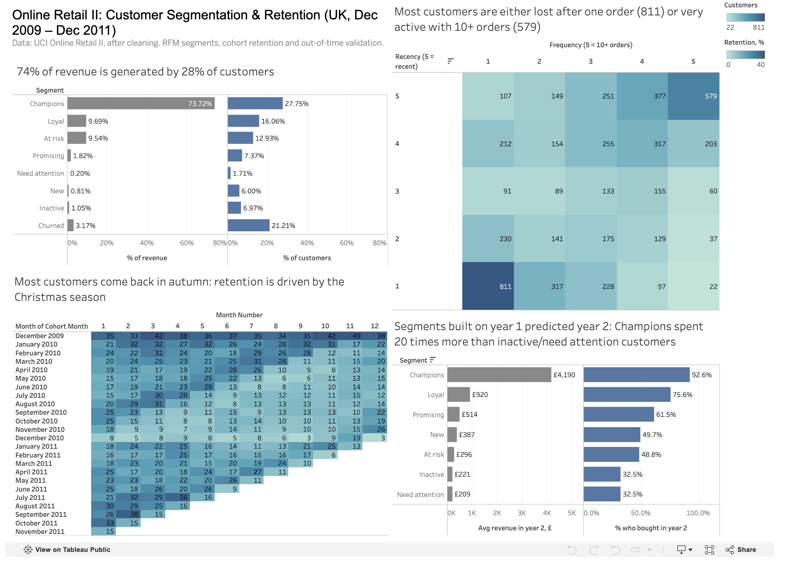

# Online Retail II – RFM & Cohort Analysis

In this project I analyzed the customers of a UK online retailer, built RFM segments and cohort retention, and compared the behaviour of different customer groups.

## Project Goal

The main goal of the project is to understand what kind of customers the company has and how they behave and spend. Moreover, I focus on which customer segments the company should invest in and which patterns explain their purchases. To conduct the research I combined Python (pandas), SQL (DuckDB) and Tableau into one analysis.
## Pipeline

1. First, I checked the data quality. The raw data had overlapping sheets (22,523 duplicated rows), cancellations, stock write-offs, bad debt adjustments, marketplace fees and test records. Each type was analysed separately and a cleaning rule was defined for it.
2. I loaded the cleaned data into DuckDB and built RFM segmentation for UK customers: recency and frequency count only completed orders, monetary is net of cancellations, delivery charges are excluded.
3. I grouped customers into monthly cohorts by their first purchase and built a retention heatmap: the share of each cohort that bought again 1, 2 … N months later.
4. Then I  built segments using only the first year of data and checked customers’ behaviour in the second year. The ranking held as 93% of first-year champions bought again and generated 73% of second-year revenue, while inactive customers mostly did not return. 

## Key Findings

RFM segmentation: 28% of the UK customers (champions) generate 74% of the revenue, while 21% of the customers (churned) generate only 3%. 'At risk' customers represent £1.30M of past revenue; winning back 20% of them could bring ~£130k per year.

Cohort analysis: only 15–30% of new customers buy again in the next month, and retention is strongly seasonal (customers come back in September–November before Christmas).

Validation: segments built on the first year predicted the second year: 93% of the first-year champions bought again and generated 73% of the second-year revenue.

## Business Impact

- **Revenue concentration:** 28% of the customers (champions) generate 74% of the revenue. Losing even a small part of this group would have a big effect on the company's revenue.
- **Revenue at risk:** 'at risk' customers (688 customers who used to buy regularly but haven't ordered for 6+ months) generated £1.30M over two years, almost as much as the 'loyal' segment. Winning back 20% of them could bring about £130k per year. This assumes returning customers spend as much as before, so it is an illustrative estimate.
- **Predictive value:** segments built on one year of data predicted the next year (93% of the first-year champions bought again), so the segmentation can be used for planning the marketing budget.

## Business Recommendations

- **Focus on the second order**. About a quarter of the customers (27%) made only one purchase, and only 15–30% of new customers buy again in the following month. New customers should get a reason to come back quickly: welcome emails, personal recommendations, a small discount for the second order.
- **Keep the champions with non-monetary benefits** (VIP status, early access to new products, a personal manager for wholesale buyers). Discounts for this group would mostly cut the margin on purchases they would make anyway.
- **Win back 'at risk' customers** with personal offers before they become fully churned. This is the segment with the highest revenue potential.
- **Use the seasonality.** Customers come back in September–November before Christmas, so retention and reactivation campaigns should start in late summer.
- **Don't spend a big budget on churned and inactive customers** (21% and 7% of the customers, but only 3% and 1% of the revenue). Automatic low-cost campaigns are enough, as the share of the revenue those segments bring is not significant enough.

## Limitations

- **Only UK customers.** The RFM segmentation was built only for the UK customers (the majority of the customer base). Foreign customers behave differently (fewer but bigger orders), so they need a separate analysis.
- **Only customers with ID.** A big part of the transactions has no customer ID, so these purchases could not be assigned to any customer and were excluded from RFM and cohort analysis.
- **Revenue, not profit.** The dataset has no information about costs and margins, so all the conclusions are based on revenue.
- **Incomplete last month.** The data ends on 9 December 2011, so the last cohorts are observed only for a few months and their retention cannot be compared with the older cohorts. Small cohorts are also noisy.
- **Manual thresholds.** Recency and frequency thresholds were chosen manually based on the distributions (monetary was split by NTILE), so other thresholds would give slightly different segment sizes.
- **Illustrative estimate.** The £130k scenario assumes that returned 'at risk' customers spend as much as before, so it is not a forecast.
- **One validation split.** The segments were validated on only one pair of years, so the result shows that the segmentation works, but does not prove it for every period.

## Tech Stack

Python (pandas, matplotlib, seaborn), SQL (DuckDB), Tableau

## Tableau Dashboard
**[Interactive Tableau dashboard](https://public.tableau.com/app/profile/arsenii.zhdanov/viz/OnlineRetailIIRFMCohortAnalysis/Dashboard1)**

## Dataset

[Online Retail II](https://archive.ics.uci.edu/dataset/502/online+retail+ii) (UCI Machine Learning Repository), downloaded from the [Kaggle mirror](https://www.kaggle.com/datasets/dvaser/online-retail-ii) via `kagglehub`. ~1M transactions of a UK online gift-ware retailer, Dec 2009 – Dec 2011.

